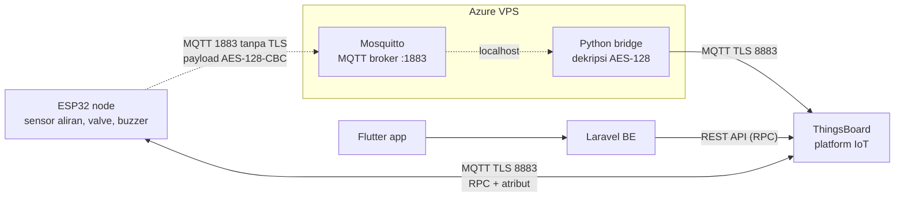

Smart Water Meter

Prototipe meter air pintar untuk PAMSIMAS. Node ESP32 membaca debit dan volume air, mengirim telemetri terenkripsi AES-128 ke cloud, dan menerima perintah valve, jadwal, serta buzzer pemborosan dari jarak jauh.

> Status: prototipe riset, bukan produk jadi. Batasan keamanan yang diketahui ada di [docs/security-and-backlog.md](docs/security-and-backlog.md). Hasil uji, termasuk yang belum diuji, ada di [docs/testing-results.md](docs/testing-results.md).

## Fitur

- Debit (L/menit) dan volume (L) dari sensor YF-B1, kalibrasi 3 titik lewat keypad
- LCD 16x2 dan menu admin berPIN
- Dua mode komunikasi: WiFi langsung ke ThingsBoard, atau LoRa lewat gateway ESP8266
- Telemetri terenkripsi AES-128-CBC (mode WiFi) lewat Mosquitto dan Python bridge
- Device provisioning otomatis: node mendaftarkan diri ke ThingsBoard saat pertama menyala
- Kontrol valve jarak jauh (RPC), jadwal harian, dan override manual
- Interval kirim adaptif: 5 detik saat ada aliran, kelipatan 15 menit saat idle
- Backlog volume 2x sehari yang dikirim ulang setelah koneksi pulih
- Buzzer indikasi pemborosan, dipicu RPC `soundBuzzer`

## Arsitektur

Dua jalur dipisah: telemetri naik lewat Mosquitto dan bridge, perintah turun lewat koneksi langsung ke ThingsBoard.



Garis putus-putus berarti tanpa TLS (isi pesan tetap terenkripsi AES). Penjelasan lengkap: [docs/system-architecture.md](docs/system-architecture.md).

## Struktur repo

```text
pamsimas-smart-water-meter/
├── README.md
├── LICENSE
├── .gitignore
├── firmware/
│   └── esp32-node/
│       ├── esp32-node.ino
│       └── secrets.example.h
├── bridge/
│   ├── bridge_auto_token.py
│   ├── requirements.txt
│   └── .env.example
├── docs/
│   ├── system-architecture.md
│   ├── security-and-backlog.md
│   └── testing-results.md
└── images/
    ├── hardware/
    ├── architecture/
    └── dashboard/
```

## Perangkat keras

| Bagian | Komponen |
|---|---|
| Node | ESP32 DevKit, sensor aliran YF-B1, LCD 16x2 I2C, keypad 4 tombol, relay + valve motor, buzzer, modul LoRa E220-900T22D |
| Gateway (jalur LoRa) | ESP8266 NodeMCU + E220-900T22D |
| Cloud | ThingsBoard Cloud, Azure VPS (Ubuntu 24.04) untuk Mosquitto dan bridge |

Keluaran sensor YF-B1 berlogika 5 V, jadi perlu pembagi tegangan atau pull-down sebelum masuk GPIO ESP32 (3,3 V).

## Memulai

### 1. Bridge (di server/VPS)

```bash
sudo apt install -y mosquitto mosquitto-clients   # konfigurasi: lihat docs/system-architecture.md

cd bridge
python3 -m venv .venv && . .venv/bin/activate
pip install -r requirements.txt

cp .env.example .env && chmod 600 .env            # lalu isi nilainya
python bridge_auto_token.py
```

Buat kunci AES acak (jangan memakai contoh dari mana pun):

```bash
python3 -c "import os;k=os.urandom(16);print('hex:',k.hex());print('C  :','{'+','.join('0x%02X'%b for b in k)+'}')"
```

Isi `hex` ke `AES_KEY_HEX` di `.env`, dan `C` ke `AES_KEY_BYTES` di `secrets.h`. Keduanya harus identik.

### 2. Firmware node

1. Arduino IDE 2.x dengan core `esp32` (dikembangkan dengan 3.3.7).
2. Library: `PubSubClient` (2.8), `ArduinoJson` (6.19.1, gunakan seri 6), `NTPClient` (3.2.1), `LiquidCrystal_I2C` (1.1.2), `WiFiManager` oleh tzapu (2.0.17).
3. Jika `USE_AES 1`: unduh `aes.h` dan `aes.c` dari [tiny-AES-c](https://github.com/kokke/tiny-AES-c) ke folder sketch.
4. `cp secrets.example.h secrets.h`, lalu isi nilainya.
5. Atur di `esp32-node.ino`: `NODE_ID` (unik per board), `DEFAULT_MODE`, `USE_FAKE_SENSOR`, `USE_AES`, `USE_TLS`.
6. Board: ESP32 Dev Module. Flash Size harus sesuai chip (umumnya 4MB). Ketidakcocokan menyebabkan bootloop dengan pesan `Detected size(4096k) smaller than the size in the binary image header`.

Pada boot pertama dengan mode WiFi, node membuka portal `PAMSIMAS-Node<ID>` untuk mengisi SSID dan password WiFi, lalu mendaftarkan diri ke ThingsBoard secara otomatis.

## Status dan rencana

| Area | Status |
|---|---|
| Node WiFi ke ThingsBoard (telemetri, RPC, jadwal) | Selesai dan diuji |
| Provisioning otomatis | Selesai dan diuji |
| Telemetri AES via Mosquitto dan bridge (WiFi) | Selesai dan diuji |
| Backlog volume | Diuji pada pemasangan sekitar 1 hari |
| Interval adaptif, buzzer | Terimplementasi; verifikasi lapangan belum didokumentasikan |
| LoRa via gateway, termasuk AES | Terimplementasi; belum diuji penuh (menunggu PCB dan power supply stabil) |
| Kalibrasi lapangan di semua node | Belum |
| Penguatan keamanan (MAC/GCM, verifikasi TLS, kunci per node, ACL Mosquitto) | Rencana |
| STM32U585 sebagai modul kripto/TEE | Eksplorasi, belum dikerjakan |

## Kontribusi

Bagian yang saya kerjakan: firmware node dan gateway, jalur telemetri terenkripsi (Mosquitto dan bridge), integrasi ThingsBoard (provisioning, RPC, atribut), dan dokumentasi. Backend Laravel dan aplikasi Flutter dikerjakan rekan tim dan tidak ada di repo ini.

## Lisensi

MIT, lihat [LICENSE](LICENSE).
