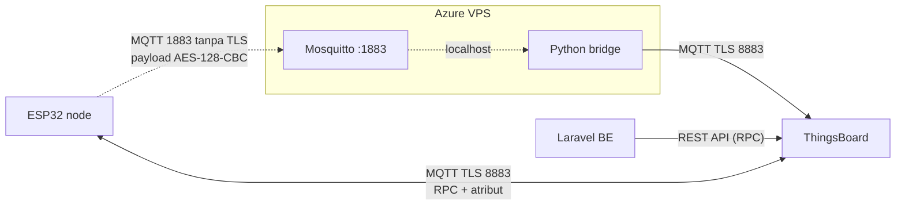
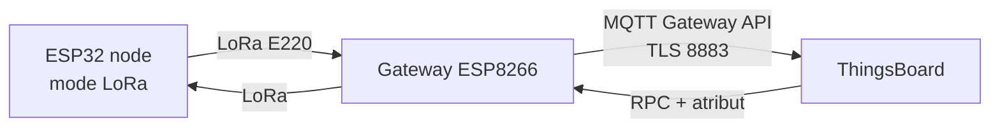

# Arsitektur sistem

## Gambaran

Node ESP32 memakai dua jalur terpisah ke ThingsBoard:

1. Jalur telemetri: data sensor dienkripsi AES-128-CBC, dikirim ke Mosquitto, didekripsi bridge Python, lalu diteruskan ke ThingsBoard.
2. Jalur kontrol: koneksi MQTT TLS langsung antara node dan ThingsBoard untuk RPC, atribut jadwal, dan provisioning.



Diagram ini menggambarkan mode WiFi dengan `USE_AES 1`. Dengan `USE_AES 0`, telemetri juga lewat koneksi langsung ke ThingsBoard (`v1/devices/me/telemetry`).

## Komponen

| Komponen | Peran |
|---|---|
| ESP32 node | Baca sensor, LCD dan menu, kontrol valve dan buzzer, kirim telemetri |
| Sensor YF-B1 | Pulsa aliran, dibaca lewat interrupt |
| Modul E220-900T22D | Radio LoRa untuk mode LoRa |
| Gateway ESP8266 | Jembatan LoRa ke ThingsBoard (MQTT Gateway API) |
| Mosquitto | Broker MQTT perantara untuk telemetri terenkripsi |
| Python bridge | Mendekripsi, mencari token device, meneruskan ke ThingsBoard |
| ThingsBoard | Registry device, penyimpanan telemetri, RPC, atribut, dashboard |
| Laravel BE | Deteksi pemborosan, mengirim RPC buzzer (repo terpisah) |
| Flutter app | Aplikasi pengguna (repo terpisah) |

## Mode komunikasi node

Mode disimpan di NVS (`commMode`) dan dipilih lewat menu admin "Mode Kirim". `DEFAULT_MODE` hanya berlaku saat boot pertama, ketika belum ada nilai tersimpan.

## Jalur 1: telemetri (WiFi, `USE_AES 1`)

1. Node membentuk JSON telemetri.
2. JSON dienkripsi AES-128-CBC. Payload `ENC:` + Base64(IV ‖ ciphertext) dipublish ke topik `sensor/encrypted/<NODE_ID>` di Mosquitto (port 1883).
3. Bridge subscribe `sensor/encrypted/#`, mengambil `NODE_ID` dari topik, membuang prefix `ENC:`, lalu mendekripsi.
4. Bridge mencari token device `Node <ID>` lewat REST API ThingsBoard (login tenant), lalu menyimpannya di `node_token_cache.json`.
5. Bridge publish JSON ke `v1/devices/me/telemetry` lewat MQTT TLS 8883 dengan token device sebagai username.

Skema enkripsi:

| Item | Nilai |
|---|---|
| Algoritma | AES-128, mode CBC |
| IV | 16 byte acak per pesan, diletakkan di awal payload |
| Padding | PKCS#7 |
| Kunci | 16 byte, dipakai bersama oleh semua node dan bridge |
| Batas plaintext | 159 byte |
| Implementasi node | tiny-AES-c, Base64 ditulis sendiri |
| Implementasi bridge | PyCryptodome |

Format telemetri (JSON sebelum dienkripsi):

| Field | Tipe | Keterangan |
|---|---|---|
| `flow` | float | Debit L/menit, terfilter (eksponensial 0,7/0,3) |
| `volume` | float | Volume akumulasi (L), tersimpan di flash |
| `valve` | 0/1 | 1 = terbuka |
| `node_ts` | string | Jam lokal node `HH:MM:SS` (WIB, UTC+7) |
| `link` | string | `wifi_direct` atau `lora` |
| `backlog` | 0/1 | 1 = entri backlog |

## Jalur 2: kontrol (koneksi langsung)

Node menjaga koneksi MQTT TLS ke ThingsBoard dengan token hasil provisioning. Node subscribe `v1/devices/me/rpc/request/+` dan `v1/devices/me/attributes`, dan membalas RPC di `v1/devices/me/rpc/response/<id>`.

| RPC | Params | Perilaku |
|---|---|---|
| `setValve` | `{"valve":0\|1,"override":0\|1}` | `valve` 1 = buka. `override` 1 = kunci manual. `override` 0 = lepas kunci dan kembali ke jadwal |
| `soundBuzzer` | `{"duration":N}` | Buzzer menyala N detik (default 5), tanpa memblokir loop. `params` boleh berupa objek atau string JSON |

Balasan RPC: `{"status":"ok"}`.

Atribut jadwal (harus bertipe Shared, atribut Server tidak dikirim ke device): `enabled`, `start_h`, `start_m`, `end_h`, `end_m`. Jendela tutup valve berjalan dari mulai sampai selesai, termasuk yang melewati tengah malam. Update parsial digabung dengan nilai tersimpan. Override manual selalu mengalahkan jadwal.

## Provisioning

1. Boot pertama tanpa token di NVS: node connect ke ThingsBoard dengan username `provision`.
2. Node publish ke `/provision/request` berisi `deviceName` (`Node <ID>`), `provisionDeviceKey`, dan `provisionDeviceSecret`.
3. Token dari `/provision/response` disimpan di NVS, lalu node reconnect memakai token itu.
4. Jika token ditolak server (rc 4 atau 5), token dihapus dan provisioning diulang.

Device Profile harus memakai strategi "Allow to create new devices". Jika nama device sudah ada dan bentrok, provisioning gagal dengan `Failed to provision device!`.

## Perilaku node

- Waktu: mode WiFi memakai NTP langsung (maks. 10 percobaan saat boot). Mode LoRa meminta waktu ke gateway lewat flag `NEEDTIME`.
- Interval kirim adaptif: jika `flow` > 0,05 L/menit, kirim tiap 5 detik. Saat idle, memakai interval menu admin (kelipatan 15 menit, maks. 24 jam).
- Backlog: lihat [security-and-backlog.md](security-and-backlog.md).

## Jalur LoRa (gateway)



Paket teks dari node: `NODE:01,Q:..,V:..,VALVE:..,TS:hh:mm:ss,NEEDTIME:0|1`. Backlog: `NODE:01,BACKLOG:1,V:..,TS:..`. Dari gateway: `TIME:hh:mm:ss`, `CMD:01,VALVE:1,OVERRIDE:1`, `CMD:01,SCHED:1,SH:..,SM:..,EH:..,EM:..`. Gateway mendaftarkan tiap node sebagai device `Node <ID>` lewat `v1/gateway/connect`. Jalur ini belum diuji penuh pada PCB (lihat [testing-results.md](testing-results.md)).

## Pemetaan pin node (ESP32)

| Fungsi | GPIO |
|---|---|
| Sensor aliran | 4 (interrupt FALLING) |
| LoRa M0, M1, AUX | 18, 19, 23 |
| LoRa UART2 RX, TX | 16, 17 |
| Tombol 1 sampai 4 | 32, 33, 25, 26 |
| Relay valve | 27 (aktif LOW) |
| LED | 2 |
| Buzzer | 13 |
| I2C SDA, SCL (LCD 0x27) | 21, 22 |

## Deployment bridge

- VPS: Azure for Students, Standard B2ats_v2 (2 vCPU, 1 GiB), Ubuntu 24.04.
- Network Security Group: inbound TCP 22 dan 1883.
- Mosquitto (`/etc/mosquitto/conf.d/pamsimas.conf`), sebagaimana dijalankan saat pengujian:

```text
listener 1883 0.0.0.0
allow_anonymous true
```

Konfigurasi ini tidak aman untuk produksi. Lihat temuan 1 di [security-and-backlog.md](security-and-backlog.md).

- Service systemd (`/etc/systemd/system/pamsimas-bridge.service`):

```ini
[Unit]
Description=PAMSIMAS AES Bridge
After=network-online.target mosquitto.service
Wants=network-online.target

[Service]
Type=simple
User=<user>
WorkingDirectory=/home/<user>/pamsimas/bridge
ExecStart=/usr/bin/python3 -u /home/<user>/pamsimas/bridge/bridge_auto_token.py
Restart=always
RestartSec=5

[Install]
WantedBy=multi-user.target
```

Memantau: `sudo journalctl -u pamsimas-bridge -f`.

## Keputusan desain

- Mosquitto dan bridge, bukan dekripsi di ThingsBoard: sandbox TBEL di Rule Engine memblokir `javax.crypto`, sehingga AES tidak bisa didekripsi di sisi ThingsBoard.
- VPS, bukan shared hosting: broker MQTT dan proses yang berjalan terus-menerus tidak bisa dijalankan di shared hosting.
- Dua koneksi di node: telemetri lewat Mosquitto, sementara RPC dan atribut tetap langsung ke ThingsBoard agar backend dan dashboard memakai RPC bawaan ThingsBoard tanpa perubahan.
- Token otomatis: node baru tidak perlu dimasukkan manual ke konfigurasi bridge.
